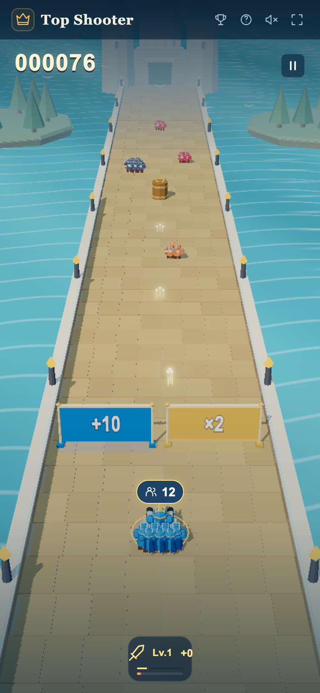
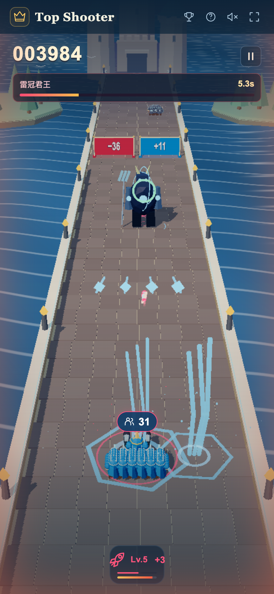
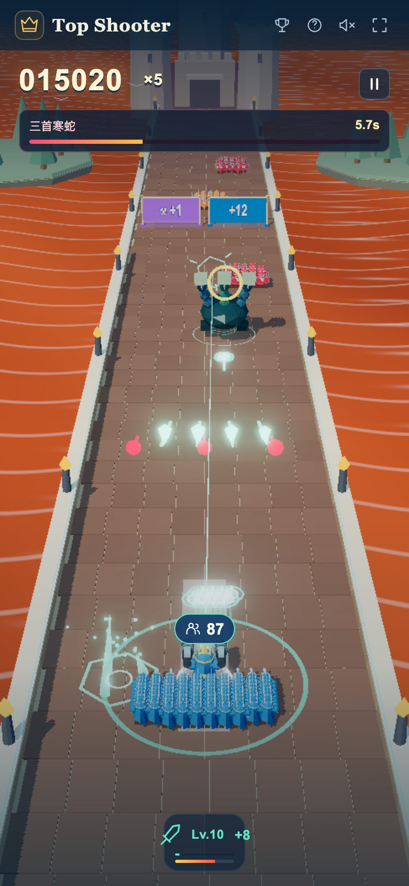
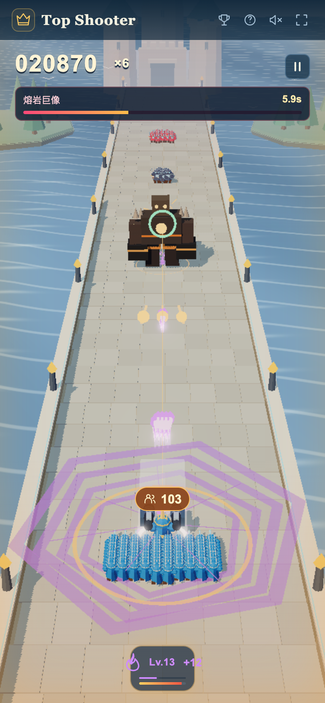

demosite: game_topshooter.html

# Top Shooter — 3D Browser Army Shooter

Build your army, unlock 20 weapons, and take on 50 Bosses in a 3D browser shooting game with endless survival. Made with TypeScript and Three.js / WebGL, Top Shooter runs on phones and desktop browsers and includes a single-file offline HTML edition.

Lead a blue army, move left and right, and fire automatically at enemies charging across a castle bridge. Recruit soldiers, improve your weapons, defeat Bosses, and beat your best score.

## Main Features

- **Easy opening:** game speed and difficulty start at **0.7**, then rise gradually to a maximum of **3** as you defeat Bosses. Time alone does not increase difficulty.
- **More intense combat from the start:** enemy squad density, enemy and Boss attack frequency, and hostile projectile speed are boosted by **20%**. The first wave includes reinforcements.
- **Beginner support:** the first three Bosses are tuned for new players. During the first ten Bosses, normal damage, heavy strikes, negative gates, and forging leave at least eight soldiers in a healthy army. Aim assistance makes side-lane shots useful and gradually decreases as difficulty rises.
- **Endless army growth:** recruit more soldiers, multiply your army, and trade a small share of troops for better gear. Every soldier contributes to damage.
- **Three gate types:** shoot recruitment gates to improve their numbers, unlock and charge multiplication gates, or charge forge gates for more gear. Only one gate in each pair can be collected.
- **Full battlefield attack range:** enemies, supplies, gates, and Bosses can be targeted as soon as they appear, up to 70 meters ahead. Aim toward their lane; projectiles still take time to reach distant targets.
- **20 weapon tiers:** earn combat experience to unlock arrows, ice shards, flames, lightning, rockets, blades, and more. Each tier has its own projectile shape, colors, trails, hit effects, and sound. Mastery keeps increasing damage after the final weapon.
- **50 Bosses and 100 special attacks:** fight distinct Boss models with named skills, colored danger zones, projectiles, and visible attack warnings. Defeat each Boss within its eight-second duel or the army is executed.
- **Combos and frenzy:** chain kills for score multipliers up to ×5. Fill the rage meter to trigger six seconds of faster, stronger attacks and double scoring.
- **Four battlefield themes:** the environment cycles through a coastal bridge, nightfall, lava, and frost every 40 seconds.
- **Responsive controls:** full-height portrait play on phones and a centered portrait battlefield on desktop. Drag, use the arrow keys, or press A / D to move.
- **Local rhythm audio:** browser-generated music and weapon sounds, with separate audio priorities for important battle cues. Sound starts after your first interaction and can be muted.
- **Local Top 10:** completed runs save your name, score, distance, kills, combo, duration, and weapon in the current browser.
- **Single-file offline edition:** the 3D engine, game logic, styles, models, and audio are included in `game_topshooter.html`.

## Game Screenshots

These screenshots show the four battlefield themes in the actual game.

| Coastal Bridge | Nightfall |
| --- | --- |
|  |  |

| Lava | Frost |
| --- | --- |
|  |  |

## Play Offline

Open [game_topshooter.html](game_topshooter.html) in a modern browser with WebGL enabled. No installation, server, or internet connection is needed. You can copy this one file to another folder or computer.

Chrome, Edge, Safari, and Firefox are supported. Music starts after pressing the start button. The game interface is in Chinese.

Scores are stored in the current browser using `localStorage`. They are not shared between devices or browsers. Clearing browser data removes the records; storage for a copied local file depends on the browser.

## Controls

| Action | Control |
| --- | --- |
| Move the army | Drag left or right; arrow keys; A / D |
| Shoot | Automatic |
| Pause or resume | Space, Escape, or the pause button |
| Toggle sound | Sound button |
| Fullscreen | Fullscreen button |
| Save a run early | Pause, then choose the finish-and-record button |

Switching away from the game automatically pauses the run.

## Difficulty and Boss Balance

Both the opening speed factor and difficulty factor are **0.7**. The opening enemy travel speed is **8.925 m/s**. Player movement, firing rate, and projectile speed remain consistent as difficulty increases.

Each of the first ten Boss defeats adds **0.01** difficulty. Later defeats add **0.02**. Difficulty reaches **3** after 120 Boss defeats and stays there. Frenzy can speed up the enemy stream, but its speed factor never exceeds 3.

A **1.2× combat pressure** setting applies from the first wave: every five ordinary enemy squads bring one extra squad, beginning with the first squad. Enemy and Boss attack intervals, including the delay before their first attack, are divided by 1.2, and hostile projectile speed is multiplied by 1.2. This increases enemy density and attack speed on top of the 0.7–3 difficulty curve.

Boss health is based on current troops, weapon damage, gear, mastery, and remaining frenzy. The health budget reserves two seconds of the eight-second duel for projectile travel, aiming, and dodging. A Boss can be attacked immediately on arrival, before the duel timer begins at 28 meters. Losing troops before the duel lowers its health budget; upgrades keep their advantage, and all damage already dealt is preserved. Health does not reset during the duel.

Early aim assistance tolerates imprecise movement and supports players who stay in a side lane. Sustained tracking increases damage. As difficulty rises, assistance decreases smoothly and accurate movement becomes more valuable. Beginner troop protection ends after the tenth Boss defeat and returns when starting a new run. It does not prevent execution when a Boss survives its duel timer.

## Development

```bash
npm install
npm run dev
```

Open the URL printed by Vite, normally `http://localhost:5173/`. A phone on the same network can use the printed Network URL.

```bash
npm run build        # Type-check, build dist/, and refresh game_topshooter.html
npm test             # Engine, difficulty, combat, gates, and beginner simulations
npm run test:browser # Browser tests; start the development server first
npm run test:offline # Rebuild and test a copied HTML file without network access
npm run benchmark    # Sample frame performance on the running game
npm run preview      # Preview the production build
```

Browser tests use a local Chrome installation. The offline tests copy the HTML to a temporary path containing spaces and non-ASCII characters and verify touch input, audio, score storage, gates, and Boss combat.

Beginner regression tests cover 12 fixed maps with four play styles: staying in the center, staying on the left, staying on the right, and making slow, imprecise decisions with occasional poor gate choices. All 48 runs must defeat at least **three Bosses** using only normal movement and starting resources. Separate tests cover ten Boss defeats with active upgrades, high-difficulty aiming, duel timing, and ten minutes of continuous spawning and restarts.

## Project Structure

| File | Purpose |
| --- | --- |
| `src/engine.ts` | Difficulty, endless spawning, army growth, gates, weapons, score, and Boss duels |
| `src/bosses.ts` | 50 Boss definitions, models, and 100 attack effect recipes |
| `src/weapons.ts`, `src/weapon-visuals.ts` | Weapon stats, projectile geometry, effects, and sound settings |
| `src/scene.ts` | Three.js battlefield, soldiers, Boss models, themes, lighting, and combat effects |
| `src/audio.ts`, `src/audio-mix.ts` | Local music, sound synthesis, mixing, and voice budgets |
| `src/leaderboard.ts` | Record validation, sorting, and local storage |
| `src/main.ts`, `src/style.css` | Touch and keyboard controls, game HUD, dialogs, and responsive layout |
| `scripts/pack.mjs` | Build the self-contained offline HTML, including the Three.js license |
| `images/` | Game screenshots |
| `tests/` | Engine, strategy, browser, weapon, Boss, and offline checks |

To keep rendering practical on phones, the game displays up to 150 representative soldiers while all troops still contribute to damage. Player projectiles, hostile projectiles, warnings, and visual effects have bounded object budgets. Slow frames use simulation substeps to preserve collisions and game time. Read-only runtime and rendering metrics are available through `window.__topShooter`.
